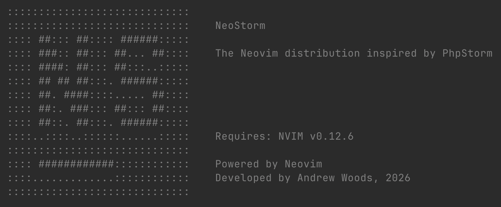

# NeoStorm

__The Neovim distribution inspired by PhpStorm__

As a PhpStorm user, who loves Neovim and the terminal, it's natural to want to
blend the two. There are some great Neovim distributions available to use.
They're all opinionated in ways that are too differently from what's common in
PhpStorm. NeoStorm makes the most of modern Neovim, Telescope, the plugin
ecosystem, while taking inspiration from PhpStorm.

As a PhpStorm user, It's amazing how much it can help you write great code. I'm
also a fan of Neovim. PhpStorm has the best Vim-bindings support across IDEs.
However, there are still gaps in support in its vim support. Also, there are
times when PhpStorm is too heavy for the work I want to do on a given day. This
project approaches the issue from the opposite direction — to put aspects of
PhpStorm into Neovim. More precisely, make Neovim act like PhpStorm while acting
while keeping the things that make Neovim great.

> [!IMPORTANT] Hypothesis 
>
> Can one create an IDE in Neovim, using the same keyboard shortcuts as
> PhpStorm? 

That's how this project started. However, many of the keystroke combinations
used in PhpStorm are unavailble. The `CMD` on Mac gets captured before reaching
Neovim. The goal isn't to duplicate every aspect of PhpStorm. *The goal is to
focus on the coding experience* — so things like LSP, code refactoring, Recent
files, linting, code formatting, etc. Additionally, it's important to have the
necessary tools (code quality, static analysis, and debugging) installed and
ready to go. Setting up your tools takes time, and is a common barrier to
creating high-quality professional code. NeoStorm wants to make it easy to do
the right thing.

## Version

The current version is 2026.11.01. This project uses [calendar versioning](https://calver.org).

Use `:NeoStorm version` to report the current version.

## Table of Contents

* [FAQ: Frequently Asked Questions](docs/faq.md) 
* [Keymaps](docs/keymaps.md)

## Features

* Powered by Telescope (requires RipGrep and FZF)
* Default Themes support (**darcula**, catpuccin, dracula, github, gruvbox)
* Quickfix Support
* Copy Path Reference
* Uses Intelephense LSP
* File Explorer Panel
* TODO Comments Panel
* Git changes navigation
* Terminal Panel
* Language-based Autoformat upon save
* Language-based code linting upon save
* LazyGit integration
* Live rendered markdown similar to Obsidian
* Copy File and Directory Paths
* Dynamic keymap menu via which-key

## Installation

> [!IMPORTANT] External Command Installation
> You'll need to include external commands. How you install them is up to you.
> Whether its via Homebrew, Apt, DNF, or a source tarball.
>
> * fzf
> * ripgrep
> * lazygit
> * psalm
>

1. Download the Neostorm repo from Github to `~/opt` and extract it
1. Create the `alias neostorm='NVIM_APPNAME="neostorm" nvim -u ~/opt/neostorm/nvim/init.lua'`
1. Run `neostorm` at the root of your project

## Credits and Acknowledgments

* Project Creator:  [Andrew Woods](https://andrewwoods.net)

